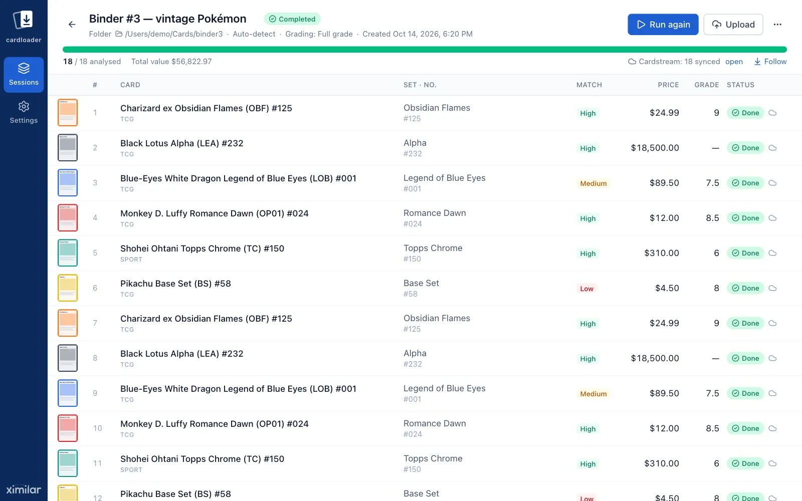

<p align="center">
  
</p>

<h1 align="center">Cardloader</h1>

<p align="center">
  Scan trading, sports and comic cards from a folder or a document scanner, identify and grade them with the
  <a href="https://docs.ximilar.com/collectibles/recognition">Ximilar API</a> or a local vision model that runs
  offline on your computer, or let your AI agent (Claude or another, over MCP) identify, price and crop them, and
  keep every run as a session — on your computer and in Ximilar Cards Cloud.
</p>

<p align="center">
  
</p>

---

Cardloader is an open-source desktop app for Windows, macOS and Linux, built with [Tauri 2](https://tauri.app)
(Rust) and React.

- **Home and setup.** On first launch, five questions (what you scan: trading card games, sports cards or comics;
  which game; whether you grade, check condition or want prices; how cards come in; and whether the Ximilar API or a
  local model identifies them) set the defaults of new sessions; run them again any time from Home or Settings. Home
  shows the cards analysed in the last 7 days, a year of activity, the last sessions and those defaults.
- **Sessions.** Each analysis of a folder, or each run of the scanner, is a session. The table fills in as
  results arrive; click a card to see its images, the best match, price statistics, grading and links. If the
  match is wrong, select one of the other candidates instead; the correction is also sent to Cards Cloud.
- **Identification.** The [Collectibles Recognition](https://docs.ximilar.com/collectibles/recognition) endpoints
  identify the cards: TCG ID (Pokémon, Magic, Yu-Gi-Oh!, One Piece, Lorcana and more), Sport ID, Comics ID and Slab
  ID. In **Auto** mode, `/analyze` detects the card type and identifies the card in one call. Rotated and
  upside-down cards are turned upright before they are identified, unless the session says every card is upright.
- **Front and back.** In a folder, images named `card_F.jpg` and `card_B.jpg` (or `_front`/`_back`, any image
  format) are paired by name; other images pair with the next one. When a session is set to **Identify from the front
  and the back**, the back goes to recognition together with the front. This helps sports cards, whose backs carry
  the player, year and number; TCG and comics identification reads the front only, because their backs look alike.
  **Magic AI** lets Sport ID identify cards that aren't in Ximilar's database (extra credits, only when it runs).
  A **custom endpoint** that Ximilar set up for you can replace the standard one; it gets the same request.
- **Local model (optional).** Cards can instead be identified on your computer, offline and for free, by a
  vision language model: Liquid AI's LFM2.5-VL (450M to 3B parameters) or Alibaba's Qwen3.5 (4B and 9B), on the
  GPU when there is one. It reads the name, collector number and year printed on the card; it can't give prices,
  other candidates or grades. See [Local model](#local-model).
- **Grading.** [Card Grading](https://docs.ximilar.com/collectibles/card-grading) can grade each card in full
  (corners, edges, surface, centering, final grade) using both sides, check its condition, or measure centering
  only. The grading overlays are saved alongside the session.
- **Add to finished sessions.** A session's ⋯ menu (or the selection bar, for ticked cards) adds prices, grading
  or crops to cards identified already, without identifying them again: prices from eBay's listings or checked by
  your AI agent, a grade, centering or the condition by Ximilar or the local model, cropped pictures by Ximilar, the
  local model or your AI agent. Ximilar's own prices come only with its identification, so they're for new sessions.
- **Cropped pictures.** Ximilar can cut each card out of its image, straighten it and even out its colours
  (`crop_level` of Card Grading); Cardloader saves the crops, front and back, named after the card's files in a
  folder you choose, as JPEG, PNG (lossless) or WebP (the file Ximilar sends, unchanged). Any session can **Also save cropped pictures**, next to identifying or grading the cards.
  The Crop tab's **Crop with** can hand the finding to the **local model** or to your **AI agent** instead: it says
  where the card's four corners are, and Cardloader cuts the card out of the full scan and straightens it, with no
  API call. Such a crop is the scan as it is (Ximilar's evening out and sharpening aren't applied), its WebP is
  lossless, and how well it fits depends on how well the corners were found, which hasn't been measured for any
  model or agent yet: look at the first crops before relying on them.
- **Pick what to do, each task by its own engine.** New session's **What to do** chooses any of **Identify**,
  **Prices**, **Grade** and **Crop**, and each chosen task gets a tab with what does it: for example identify with
  Ximilar, grade with the local model and price with your AI agent or from eBay's listings (all of them, or the
  ones the local model or your agent says are the card). Cards overlap: as soon as one is identified the next
  one starts, while the first goes on to its grade, crop and price. Each card does what answers quickly first
  (Ximilar's grade and crop, a plain eBay price), then what the local model does, then what waits for your agent,
  so a grade never waits for a price your agent hasn't given yet. Without **Identify**, a
  session sends each card straight to grading (a full grade, centering or its condition) or just saves the crops.
- **Scanner.** Cardloader drives a RICOH/Fujitsu **fi-8170**, or any SANE/TWAIN document scanner, in duplex batches.
  Front and back are paired automatically, in the order you feed them (front or back first), and pages fed upside
  down can be turned as they are scanned. On Windows, **Settings → Scanner → Driver settings…** opens the scanner's
  own options (such as automatic cropping and deskew), and every scan keeps them.
- **Watch folder.** Cardloader can also analyse images as another app saves them into a folder, for example
  PaperStream Capture.
- **Cards Cloud.** Sessions can be mirrored live to
  [Ximilar Cards Cloud](https://app.ximilar.com/login?open=cards-cloud). Each card is uploaded with its image,
  match, prices and grading, and the Cards Cloud tab lets you browse what is stored there.
- **Continue a session.** Paste a Cards Cloud session's ID (or link) into the New session dialog to add cards to
  it, e.g. from another computer. Images of the folder that the session already has, matched by file name, are
  skipped.
- **Sell on eBay.** List a session's cards on eBay with your own eBay developer keys: each card becomes a draft with
  its pictures, title, item specifics and condition (graded slabs with their grader and grade), at Ximilar's price
  or yours. Publish the drafts when they look right; Cardloader then shows which listings sold. See
  [Selling on eBay](#selling-on-ebay).
- **Listing titles your way.** Choose which parts of a card make its title and in what order, add words of your
  own (`{name} {year} {set} {series} Auto {printRun} #{number}`), with templates for sports cards, trading cards,
  comics, graded cards, autographs, parallels or regular cards; every title shows its length against eBay's 80
  characters and leaves out what matters least instead of being cut off. Tick cards to add a text to all their titles at once. See
  [Listing titles](#listing-titles).
- **TCGplayer, Whatnot and Shopify.** Export a session's ungraded trading cards as a TCGplayer list (with each card's
  TCGplayer product link), as Whatnot's bulk listing CSV for auctions and Buy it Now, or as Shopify products with
  condition variants (or a Shopify inventory update), with the pictures uploaded to ImgBB. See
  [TCGplayer, Whatnot and Shopify](#tcgplayer-whatnot-and-shopify).
- **CSV import and export.** Import a spreadsheet as a new session: rows with a card name come in as identified
  cards, rows with only an image path are analysed. Any session can be exported to CSV, and an export imports
  back as it was.
- **Manage sessions.** Search and filter them, rename them (the Cards Cloud copy follows), change their settings,
  duplicate them to analyse the same source again, export the cards to CSV, and delete one or several at once,
  optionally with their Cards Cloud copies. Remote sessions can be renamed and deleted from the Cards Cloud tab.
- **Review.** Every identified card is to review until you accept or correct it. Filter a session to the cards to
  review (sort by Match to see the unsure ones first), failed or corrected
  ones, or search it. Accept a match with **A** (cards to review show an amber question mark, accepted ones a green check; **A** again, or **Unaccept**, takes it back), pick a candidate with **1–9**, edit a card's name, set, number,
  price, location or notes with **E**, and move with **J**/**K**; press **?** for all shortcuts. Tick cards (Shift
  for a range) to accept, edit, analyse again, set where they are kept or delete them at once. Corrections are sent to
  Cards Cloud too. A notification tells you when a session has finished while you were in another app.
- **Home.** Your cards, their total value, the cards to review and the API calls of the last 7 days; a list of
  what needs attention (sessions to review, failed cards, interrupted sessions to resume, upload errors); and a year
  of activity. **New session** estimates the API calls before you start.
- **Cards.** Every identified card of your sessions in one list: search by name, set, number, location or notes,
  filter to cards to review, graded cards or duplicates (×3 shows you have three), with the total value. Tick cards
  to set where they are kept (a box, a binder page). When listing or exporting, **Adjust prices** sets the chosen
  cards to a percentage of the market price, ending in .99, with a minimum.
- **Upside-down cards.** When Ximilar finds a card upside down in its image, the card shows an **Upside down**
  badge; click it and **Turn upright** to turn the pictures the app shows and exports upload, front and back (and
  the scans, for scanner sessions). Tick several cards and click **Turn upright** to turn those that are upside
  down at once. Images in your own folders are never changed.
- **AI agents.** Claude Desktop, Claude Code, Cursor and other AI apps can work with Cardloader over MCP: start a
  session on a folder, wait for it, and review its cards by looking at their pictures. Cards an agent accepts get an
  AI mark until you confirm them. See [AI agents](#ai-agents-mcp).
- **Pause, stop, resume.** You can pause, stop and resume a session, even after the app restarts. Failed cards can
  be retried individually. When the connection drops, the session pauses instead of failing its cards.

## Install

Download the installer for your platform:

| Platform | Download |
| --- | --- |
| macOS 11+ (Apple silicon + Intel) | [Cardloader .dmg][dl-dmg] |
| Windows 10/11 | [Installer (.exe)][dl-exe] or [.msi][dl-msi] |
| Linux | [.AppImage][dl-appimage], [.deb][dl-deb] or [.rpm][dl-rpm] |

[dl-dmg]: https://github.com/Ximilar-com/cardloader/releases/download/v0.8.7/Cardloader_0.8.7_universal.dmg
[dl-exe]: https://github.com/Ximilar-com/cardloader/releases/download/v0.8.7/Cardloader_0.8.7_x64-setup.exe
[dl-msi]: https://github.com/Ximilar-com/cardloader/releases/download/v0.8.7/Cardloader_0.8.7_x64_en-US.msi
[dl-appimage]: https://github.com/Ximilar-com/cardloader/releases/download/v0.8.7/Cardloader_0.8.7_amd64.AppImage
[dl-deb]: https://github.com/Ximilar-com/cardloader/releases/download/v0.8.7/Cardloader_0.8.7_amd64.deb
[dl-rpm]: https://github.com/Ximilar-com/cardloader/releases/download/v0.8.7/Cardloader-0.8.7-1.x86_64.rpm

Release notes and earlier versions are on the [Releases](https://github.com/Ximilar-com/cardloader/releases) page.

> Early builds may be unsigned. On macOS, the first launch says Apple could not verify Cardloader: click **Done**,
> then **System Settings → Privacy & Security → Open Anyway**. On Windows, choose **More info → Run anyway** in
> SmartScreen.

To build and install from source instead, see [Development](#development) and run `just install`.

## Getting started

1. On first launch, pick the app's language — English, 日本語, Español, 한국어, Français, Português, Deutsch or
   Italiano (change it later in **Settings → Language**) — then answer the setup questions (or skip them); they set
   the defaults of new sessions. The translations are machine-made; corrections from native speakers are welcome.
2. Open **Settings**, paste your Ximilar API token and click **Test connection**. You can find the token in the
   [Ximilar App](https://app.ximilar.com). Collectibles recognition needs the Business plan or a trial;
   Cards Cloud sync needs the Cards Cloud service on your account. The token is stored in the system keychain.
3. Click **New session** (on Home or Sessions). Under **What to do**, tick what the session does (**Identify**,
   **Prices**, **Grade**, **Crop**), pick the source (a folder, a watch folder, a scanner or a CSV file), choose in each
   task's tab what does it (the Ximilar API, a local model or an AI agent), then click **Create & run**.
4. Watch the cards come in. Click any row to see its details. Use **Pause** and **Stop** whenever you like;
   **Run again** picks up where the session left off, including new files added to the folder.

To bring in cards you already have in a spreadsheet, click **Import CSV** instead (see below).

Every analysed card costs Ximilar API credits: one call per recognition (two in Auto mode), plus one per
grading and one per crop by Ximilar. A grade-, condition- or crop-only session makes one call per card (two if it also crops). Cards Cloud bills one call per session and one per stored image. See [Ximilar pricing](https://www.ximilar.com/pricing/).

## Local model

**Settings → Local models**: pick a model, accept its license and download it (with progress; downloads can be
cancelled and resumed). **Settings → New sessions → Identification → Local model** makes it the default engine of new
sessions. Each session keeps the engine and model it was created with, and **New session** can pick another
downloaded model per session.

| Model | Download | Memory | Time per card |
| --- | --- | --- | --- |
| [LFM2.5-VL 3B](https://huggingface.co/LiquidAI/LFM2.5-VL-3B-GGUF) (default) | 2.3 GB | ~2.5 GB | 3.2 s |
| [LFM2.5-VL 450M](https://huggingface.co/LiquidAI/LFM2.5-VL-450M-GGUF) | 330 MB | ~0.6 GB | 0.7 s |
| [LFM2.5-VL 1.6B](https://huggingface.co/LiquidAI/LFM2.5-VL-1.6B-GGUF) | 1.3 GB | ~1.5 GB | 1.9 s |
| [Qwen3.5 4B](https://huggingface.co/unsloth/Qwen3.5-4B-GGUF) | 3.4 GB | ~4 GB | 7 s, with the back 16 s |
| [Qwen3.5 9B](https://huggingface.co/unsloth/Qwen3.5-9B-GGUF) | 6.6 GB | ~7 GB | 14 s, with the back 22 s |
| [Gemma 4 E4B](https://huggingface.co/unsloth/gemma-4-E4B-it-GGUF) | 6.0 GB | ~7 GB | 6.6 s |
| [Gemma 4 12B](https://huggingface.co/unsloth/gemma-4-12b-it-GGUF) | 7.3 GB | ~9 GB (estimate) | not measured yet |

Times are for a MacBook Air M4 (Metal; it slows down during long runs); a CPU is slower, and the Qwen3.5 models want
a GPU. How often the name and the number came out right on labelled test cards (Magic and Pokémon: clean scans;
sports: sellers' photos of 100 cards from 2026 sets, 20 each of five sports):

| Model | Magic (20) | Pokémon (20) | Sports (100) | Sports, front and back |
| --- | --- | --- | --- | --- |
| LFM2.5-VL 450M | 18 / 12 | 12 / 16 | 68 / 0 | 68 / 33 |
| Qwen3.5 4B | 20 / 20 | 19 / 16 | 76 / 0 | 88 / 79 |
| Qwen3.5 9B | 20 / 20 | 19 / 17 | – | 87 / 88 |

Modern sports cards print the card number on the back, so no model finds it on the front alone. A local session
says what it holds (**New session → Identify as**: trading cards, sport cards or comics); for sport cards **Use front
and back for identification** is on by default (the others can turn it on): it pairs each front with its back and
every model reads the back too. The 9B model gets the most of those numbers (on 51 more photos, mostly signed
baseball cards in holders: 47 against 4B's 32 and 450M's 10); elsewhere it reads no better than 4B. To choose, run
**Compare with local model** on your own cards (below).

- The model runs in the app through [llama.cpp](https://github.com/ggml-org/llama.cpp). The model is loaded once (a
  few seconds) and reads one card at a time.
- **GPU.** Macs use Metal. On Windows and Linux, Cardloader uses any NVIDIA, AMD or Intel GPU through Vulkan, which
  comes with the GPU's driver; without one it runs on the CPU. **Settings → Local models → Run on** chooses:
  **Automatic** (the GPU with the most free memory, a dedicated one before an integrated one), **CPU only**, or one
  GPU. A model larger than the GPU's free memory runs partly on the CPU; if the GPU can't load it at all, it runs
  on the CPU and Settings says why.
- The Qwen3.5 and Gemma 4 models read the whole card in one look (and its back, if the session reads both sides).
  The Gemma 4 models are new and not yet scored on the test cards above. On 5 photos of Magic cards, E4B read all 5
  names and 3 numbers, and left the other two empty (printed too small to read; Qwen3.5 4B and 9B read all 5, at
  9.6 s and 17.6 s per card); 12B hasn't been measured. Try them with **Compare with local model** on your own
  cards. The LFM models
  take two quick looks: the whole card for the name, year and game, then for the card number the back of a sports
  card (when the session reads both sides) or the enlarged bottom edge of the front, which works when the card fills
  the picture (a scan), not on a photo of a card on a table. The answer's game is one of the session's kind of
  cards. The answers are held to a fixed JSON shape, so they always parse.
- **Comics.** A local session of comics asks about the cover instead: the title of the series, the issue number,
  and the publisher and year when they are printed. The Qwen3.5 models read the cover in one look; the LFM models
  read the title off the whole cover and the issue number off its enlarged top quarter, where older comics print it
  by the date and the price. On scans of 11 covers from the 1940s, Qwen3.5 4B and 9B each got 8 titles and 9 issue
  numbers right (the titles missed lost a letter behind the artwork); LFM2.5-VL 450M got 7 titles and 4 numbers, and
  gave a wrong number on 3. Modern covers, which often print the number in the barcode box, weren't measured. The
  back cover is never read.
- **Crops.** With **Crop with: Local model**, the model is asked where the card's four corners are in each
  picture (as points in thousandths of the picture) and Cardloader cuts the card out of the full scan there and
  straightens it, as the card lies in the picture: a card photographed upside down stays upside down. Every model
  gets the same question, and none has been measured at it: small models in particular may place corners loosely.
- What it can't do: tell reprints and variants apart, give a match score, other candidates or prices.
  Rows show a **Local** tag instead of High/Medium/Low. Cards Cloud sync still works (with your Ximilar token).
- **Grading and condition (estimates).** A local session can also grade: each side gets one more question, and
  the card takes the worse side. **Condition** picks a label of the chosen scale (TCGplayer, Cardmarket, eBay
  trading cards or eBay sports cards; Settings → New sessions sets the default, the New session dialog per session).
  **Full grade** asks for corners, edges, surface and centering from 1 to 10 and caps the final grade one point
  above the weakest. Both are rough estimates of a small model, not a grader's opinion.
- **How good is it on your cards?** On a session identified by Ximilar, **⋯ → Compare with local model…** runs
  a downloaded model on the same cards and shows how often the name and the number agree, and how long each card
  took. Run it again with another model to compare models side by side. The session itself isn't changed.
- **Licenses.** The LFM2.5-VL models are made by Liquid AI under the
  [LFM Open License v1.0](https://www.liquid.ai/lfm-license), which limits commercial use above a revenue threshold.
  The Qwen3.5 models are made by Alibaba's Qwen team under the
  [Apache License 2.0](https://www.apache.org/licenses/LICENSE-2.0), which allows commercial use, as are Google's
  Gemma 4 models (GGUF files by Unsloth). Each is downloaded from Hugging Face after you accept its license, never bundled.
- Models are stored in the app's data folder under `models/`; **Delete** in Settings removes them.
- **Another model.** The seven above are the ones Cardloader ships with. A fork can add any other vision model from
  Hugging Face, however large: see [Adding another model](#adding-another-model).

### Adding another model

In your own fork, a model is one entry in the catalog, `MODELS` in
[`src-tauri/src/local/catalog.rs`](src-tauri/src/local/catalog.rs); the app then lists it in Settings, downloads it
and uses it like the others. Nothing else has to change. You need to build the app yourself
([Development](#development)).

**What the model must be**

- A vision language model that [llama.cpp runs with pictures](https://github.com/ggml-org/llama.cpp/blob/master/docs/multimodal.md)
  (Gemma 3, Qwen2.5-VL, Pixtral, InternVL and others), as two GGUF files: the model and its vision projector
  (`mmproj`). A text-only model can't read cards. A model newer than the llama.cpp Cardloader is built with also
  needs a newer `llama-cpp-2` in `src-tauri/Cargo.toml`.
- In a public Hugging Face repository that downloads without a login, each of the two as one file. A model split
  into parts (`…-00001-of-00003.gguf`) isn't supported: take a smaller quant.
- Small enough for your computer. To run fast, the files plus about a tenth have to fit in the GPU's memory (on a
  Mac: in its memory). What doesn't fit runs on the CPU, slowly. A model runs on one GPU.

**Steps**

1. List the repository's files, then let the script write the entry with the pinned revision, the sizes and the
   SHA-256 of the two files you chose (Q4_K_M is the usual model file; take the `mmproj` as F16 or Q8):
   ```sh
   just model-entry ggml-org/gemma-3-4b-it-GGUF
   just model-entry ggml-org/gemma-3-4b-it-GGUF gemma-3-4b-it-Q4_K_M.gguf mmproj-model-f16.gguf
   ```
   Without `just`: `node scripts/model-entry.mjs …`. `--rev <commit>` pins an older revision.
2. Paste what it prints at the end of `MODELS` and fill in the lines marked `TODO`: the name, who made the model, and
   its license (the license note people accept before downloading is made from these).
3. Check the entry and try the model:
   ```sh
   cargo test -p cardloader catalog   # says what is wrong with an entry
   just dev                           # Settings → Local models → download it
   ```
   Then make a session with it, or run **Compare with local model** on a session Ximilar identified to see how
   often the two agree.

To make it the model new installs start with, set `DEFAULT_MODEL` to its id and move its entry to the top (an
install that already has settings keeps the model chosen there).

**The `profile` of an entry** holds what differs between models. `Profile::GENERAL` suits most; change single fields
with `Profile { context_tokens: 16_384, ..Profile::GENERAL }`:

| Field | `GENERAL` | Change it when |
| --- | --- | --- |
| `whole_card` | `true` | The model is small (under about 2B) and misreads the collector number: `false` asks twice, the second time about the enlarged bottom of the card (as the LFM models are asked). |
| `answer_prefix` | `""` | The model thinks before answering and its answers are slow or worse than they should be: the text that ends its thinking, e.g. `"<think>\n\n</think>\n\n"` for Qwen3.5. |
| `chat_template` | `None` (the one in the GGUF) | Loading fails with "llama.cpp doesn't know this model's chat template": the name of one of [llama.cpp's templates](https://github.com/ggml-org/llama.cpp/wiki/Templates-supported-by-llama_chat_apply_template), e.g. `Some("chatml")`. |
| `turn` | `None` | None of llama.cpp's templates fits: the user's turn written out, with `{prompt}` where the question goes and the opening of the answer at the end, e.g. Gemma 4's `Some("<\|turn>user\n{prompt}<turn\|>\n<\|turn>model\n")` (`Profile::GEMMA4`). |
| `context_tokens` | `8192` | A card fails with "more than the model's context": raise it (or lower `card_long_edge`). Pictures take most of it. |
| `card_long_edge` | `1024` | Small print is misread: a larger picture shows more and takes longer. |

The questions, and the grammar that holds each answer to its JSON fields, are the same for every model
(`src-tauri/src/local/identify.rs`, `grade.rs`). Tried this way, Google's Gemma 3 4B (the commands above, with
`Profile::GENERAL` as written) got 19 names and 18 numbers of the 20 Magic test cards right, at 15 s per card on
an Apple M4.

**Measuring it.** The opt-in tests run the real model outside the app. `CARDLOADER_MODELS` is a folder with
`<id>/` inside, such as the app's own `models/` folder ([Where data lives](#where-data-lives)):

```sh
# Download with the app's downloader
CARDLOADER_MODEL=<id> CARDLOADER_DOWNLOAD_TO=/path/to/models \
  cargo test --release -p cardloader real_download -- --ignored --nocapture
# Read every picture in a folder and print the answers
CARDLOADER_MODEL=<id> CARDLOADER_MODELS=/path/to/models CARDLOADER_CARDS=/path/to/cards \
  cargo test --release -p cardloader real_model_reads_cards -- --ignored --nocapture
# Score against a CSV next to the pictures: columns file (or front, back), name (or player), number
CARDLOADER_MODEL=<id> CARDLOADER_MODELS=/path/to/models CARDLOADER_TRUTH=/path/to/cards/truth.csv \
  cargo test --release -p cardloader real_model_scores_cards -- --ignored --nocapture
```

`CARDLOADER_KIND=tcg`, `sport` or `comics` is the session's "Identify as"; `CARDLOADER_BACKS=1` sends the backs too.

- Files you already have can be put into `models/<id>/` in the app's data folder under the names in the entry;
  the app takes them as downloaded.
- On Windows and Linux, build with `--features vulkan` (or `cuda`) for the GPU, as described under
  [Development](#development).
- For a pull request to Cardloader, a model also needs its measured memory, time per card and accuracy in the tables
  above, an entry in [THIRD_PARTY.md](THIRD_PARTY.md) and a copy in `src/lib/demo.ts` (the browser demo). A private
  fork needs none of these.

## Selling on eBay

Cardloader lists cards through eBay's Sell APIs with **your own eBay developer keys**: an open-source app can't
ship eBay's client secret, and nothing runs on a server in between.

1. Join the [eBay developer program](https://developer.ebay.com/) and create a keyset (Sandbox to try it out,
   Production for real listings). eBay activates a Production keyset once you either subscribe to Marketplace
   Account Deletion notifications or apply for the exemption (Cardloader keeps no eBay user data on a server).
2. Under **User Tokens** of the keyset, add an eBay Redirect URL (RuName). Leave its "auth accepted" URL as eBay's
   own page.
3. In **Settings → Selling**, choose the environment and enter the App ID, Cert ID and RuName, then **Connect eBay
   account** and agree on eBay's page. The login lasts about 18 months and is kept in the system keychain.
4. Choose the shipping, payment and return policies and where cards ship from. Accounts without business policies
   can turn them on there; create the policies in eBay's Seller Hub.
5. On a finished session, **⋯ → List on eBay…** shows each identified card with its title, category and condition.
   Prices come from Ximilar; cards without one need a price. **Create drafts** uploads the pictures and creates
   unpublished listings, which you can check on eBay.
6. **Publish on eBay** makes the drafts live. The session shows how many are drafts, listed and sold; listings are
   checked again when the session is opened (at most every 10 minutes) or with the refresh button.

Cards go to eBay US: trading cards to *CCG Individual Cards*, sports cards to *Sports Trading Card Singles*. A card
in a graded slab is listed as Graded with its grader, grade and certificate number; other cards as Ungraded in the
condition chosen in the dialog (Ximilar's own grade is an estimate, not a professional grade). Comics go to *Comics
& Graphic Novels* with their series title, issue number, publisher, year and era, and a slab's grader, grade (CGC
9.8 stays 9.8) and certificate number as item specifics; their conditions and item specifics follow eBay's comics
listings and haven't been tried against eBay yet. Listing fees and selling limits are eBay's.

### Listing titles

Without any setup a trading card's title is *year, game, set, name, #number* and a slab's grader and grade, e.g.
`2023 Pokemon Obsidian Flames Charizard ex #125 PSA 10`; a sports card's is *year, set, name, series (the
parallel), features, serial number, #number, grade*, e.g. `2023 Prizm Victor Wembanyama Silver Prizm RC #136`; a
comic's is *title, #issue, year, publisher, grade*, e.g. `Amazing Spider-Man #300 1988 Marvel CGC 9.8`. eBay,
Whatnot and Shopify get the same title. Every way of identifying (Ximilar, a local model, an AI agent, a CSV) fills
the same fields, so a template works the same for all of them.

- **Templates** (**Settings → Selling → Listing titles**, or **Title templates** next to a card's listing title):
  add a template and put its parts in order as chips, or write it as a pattern, e.g.
  `{name} {year} {set} {series} Auto {printRun} #{number}` →
  `Fábio Vieira 2025-26 Topps Chrome Bundesliga Green Wave Auto /99 #BA-FV`. The parts are `{year}`, `{brand}`,
  `{set}`, `{name}`, `{series}`, `{features}`, `{serial}` (`70/99`), `{printRun}` (`/99`), `{number}`, `{team}`,
  `{grade}`, `{game}` and `{setCode}`; everything else is your own words, which stay in every title. A part the
  card doesn't have drops out together with the word it is in (`({team})`, `#{number}`), and a lone `-` or `|`
  goes with it. A template is for all cards, sports cards, trading cards or comics, and optionally only for graded
  cards, autographs (Features say *Auto* or *Autograph*), parallels (a serial number, or a sports card whose
  Series names a parallel) or regular cards (none of those). The first template in the list that is for a card
  makes its title; cards no template is for keep the usual title. The preview below shows your newest cards with
  the templates as you edit them.
- **80 characters.** Every title shows its length, e.g. `76/80`. A title that would be longer keeps the name, the
  card number, the grade and your own words, and then takes the other parts while they fit, in this order of
  importance: serial number, print run, features, series, set, set code, brand, year, game, team. The preview says what was left out. A part
  another part already says isn't repeated (`Topps` before the set `Topps Chrome`).
- **Brand, team, serial number, features** are fields of a card, shown and edited with the others (**E**).
  Ximilar fills in the brand, team and serial number of sports cards; Features (`RC`, `Auto`, `Flagship`, …) is
  yours to type. Typing them doesn't accept the card, and they aren't sent to Cards Cloud.
- **A card's own title.** Edit a card and type its **Listing title** to replace the automatic one; **Back to the
  automatic title** returns to the template's. A card with its own title is marked **Custom** and templates no
  longer change it; a new analysis or another candidate picked drops it.
- **Many cards at once.** Tick cards in a session or on the Cards page and click **Edit…**: add a text at the
  start or end of their listing titles, or to their Features, Series, Brand or Team (or put it in place of what is
  there). The dialog shows every card's title before and after with its length. A text added to a title leaves
  the rest to be fitted around it, and makes the title the card's own; a card that can't take it (the title would
  pass 80 characters) is skipped. A text added to a field shows in the titles whose template has that part.

## TCGplayer, Whatnot and Shopify

A session's **⋯** menu has **Export for TCGplayer…**, **Export for Whatnot…** and **Export for Shopify…**. Both show the cards with their
prices (from Ximilar; cards without one need a price) and a condition for ungraded cards whose condition wasn't
graded.

- **TCGplayer**: a CSV of the ungraded trading cards in TCGplayer's terms — product line, set, name, number,
  condition (Near Mint, Lightly Played, …), quantity and price, plus the TCGplayer product id and link from the match.
  TCGplayer doesn't give API access to new apps, and its Seller Portal import takes only its own export files (they
  carry its SKU ids), so add the cards in Seller Portal from this list. Graded cards are sold there only as Listings
  with Photos, and TCGplayer has no sports cards or comics; they are left out.
- **Whatnot**: Whatnot's bulk listing CSV (its US template), for Seller Hub → Inventory → **Import from CSV** (draft
  listings) or a show's **Upload CSV**. Choose Auction (the price is the starting bid) or Buy it Now, and a shipping
  profile. Trading cards, sports singles and entertainment cards get Whatnot's categories and conditions; slabs are
  listed as Graded with the grader, grade and certificate in the title and description. Whatnot downloads pictures
  from public links, so with an [ImgBB](https://api.imgbb.com/) API key (Settings → Selling) the export uploads each
  card's front and back there first, once per card. Without a key, add the photos in Whatnot. Comics are left out:
  Whatnot's import refuses a row whose category isn't exactly its template's, and its comics categories aren't
  known here yet.
- **Shopify**: Shopify's product CSV (Products → **Import**) or its inventory CSV (Products → Inventory →
  **Import**).
  - *Products*: either one product per card (name, set and number), its conditions (Near Mint, Lightly Played, …) as
    variants with the number of copies and the highest of their prices, or one product per scanned card. A graded slab
    is always its own product with the grader and grade in its title. A comic is a *Comic Book* (or *Graded Comic*)
    of its publisher, in Shopify's Comic Books category, one product per title, issue and year, its conditions Near
    Mint, Very Fine, Very Good and Poor. Products get Shopify's trading card category,
    tags (game, set, year, grader), a description, and the pictures (uploaded to ImgBB, as for Whatnot). They are
    drafts unless you choose to publish. Handles are made from the card, so importing again with **Overwrite products
    with matching handles** updates the same products.
  - *Inventory update*: sets each product's stock at a location (named exactly as in Shopify) to the number of
    copies — for stores with several locations, or to restock products imported before (choose the same grouping).

## AI agents (MCP)

Cardloader includes an [MCP](https://modelcontextprotocol.io) server, so AI apps can drive it. Turn it on in
**Settings → AI agents**, choose what agents may do, and copy the setup for your app from the same page:

- **Claude Desktop:** click **Add to Claude Desktop** in Settings → AI agents, then quit and reopen Claude. Or add
  the server to its config file by hand. The file is
  `~/Library/Application Support/Claude/claude_desktop_config.json` on macOS and
  `~/.config/Claude/claude_desktop_config.json` on Linux (make it if there is none):

  ```json
  { "mcpServers": { "cardloader": { "command": "/Applications/Cardloader.app/Contents/MacOS/cardloader", "args": ["mcp"] } } }
  ```

  On Windows, Claude Desktop keeps the file in `%LOCALAPPDATA%\Claude-Data\<package>\`, earlier versions in
  `%LOCALAPPDATA%\Packages\Claude_…\LocalCache\Roaming\Claude\`, and only a PC that had its old installer in
  `%APPDATA%\Claude\`. Claude's own **Edit Config** opens that last one whichever it reads, so an entry added
  there may do nothing. **Add to Claude Desktop** finds the file, and Settings names it. Run Cardloader and Claude
  as the same Windows user, not as administrator: another account has its own settings and token.

- **Claude Code:** `claude mcp add cardloader -- /Applications/Cardloader.app/Contents/MacOS/cardloader mcp`
- **OpenAI Codex:** `codex mcp add cardloader -- /Applications/Cardloader.app/Contents/MacOS/cardloader mcp`
- **Cursor, Gemini CLI, LM Studio:** the same `mcpServers` entry as Claude Desktop, in `~/.cursor/mcp.json`,
  `~/.gemini/settings.json` or LM Studio's `mcp.json` (Program tab → Install → Edit mcp.json).
- **Other apps** connect over HTTP to the address Settings shows (`http://127.0.0.1:47821/mcp`) with the header
  `Authorization: Bearer <token>`.

The program path differs on Windows and Linux; Settings shows the right one. `cardloader mcp` passes messages
to the open app. On macOS it opens the app if it isn't running; elsewhere, open Cardloader first. The server listens
on 127.0.0.1 only and needs the token.

Then ask, for example:

- “Run a new Cardloader session on ~/Cards/pokemon-en: English Pokémon, fronts only, store it in Ximilar.”
- “Review the latest Cardloader session: check each card against its picture and accept the right ones.”
- “Identify the cards in ~/Cards/football yourself with Cardloader.”

### Let your agent identify the cards

With **Identify with: AI agent (MCP)** (in New session, or `engine: "agent"` when the agent creates the session),
Cardloader does everything but the identification: it reads the folder, watches it or runs the scanner, pairs
fronts and backs, and then hands each card to your agent with its pictures (`next_cards_to_identify`). The agent
reads the name, set, number, year and variant and answers with `identify_cards`, or says it can't tell a card,
which then fails with its note. The session then goes on as usual: grading and crops (through Ximilar unless the
session says otherwise) if it asks for them, Cards Cloud, exports. Each card the agent identified shows **AI agent** as its confidence,
with the agent's certainty and note, and waits for your review like any other. While cards wait, the session page
says so; nothing is identified without the agent. The **Identify cards yourself** prompt (`identify_session`)
walks an agent through it. An agent session needs no Ximilar token unless Ximilar grades or crops for it, or it
syncs. By default
the agent is told to read each card from its pictures alone; **Settings → AI agents → Search the internet** lets it
look up a card's set, number or parallel (and, when pricing, recent sales) online: slower and costlier, but more
precise.

An agent can price the cards too: choose **Prices** in New session and price them with **AI agent (MCP)** (or
`prices: "agent"` in `create_session`; with **eBay listings + AI agent** it chooses among the listings Cardloader
finds instead, see [Prices from eBay](#prices-from-ebay)). Once a card is identified, by whatever identifies the session's cards, it
waits for the agent's price (`next_cards_to_price`, answered with `price_cards` in US dollars and a note shown under
the card's price). The **Price cards yourself** prompt (`price_session`) walks an agent through it.

### Let your agent crop the cards

With **Crop with: AI agent (MCP)** in New session's Crop tab (or `crop_engine: "agent"` in `create_session`, with
`task: "crop"` or `save_crops`), your agent finds each card in its pictures and Cardloader does the cutting. Each
card waits for the agent with its front and back picture and their size in pixels (`next_cards_to_crop`); the agent
answers with the four corners of the card in each picture (`crop_cards`), clockwise from the card's own top-left
corner, so a card lying sideways or upside down comes out upright. Cardloader cuts the card out of the full scan at
those corners, straightened, into the session's crop folder, with no call to Ximilar. `preview_crop` shows the agent
the cut its corners give before anything is saved, so it can correct them. A card with a back picture needs the
back's corners too, or the reason it has none; a picture with no card fails the card's crop with the agent's note.
The **Crop cards yourself** prompt (`crop_session`) walks an agent through it. How closely an agent places the
corners hasn't been measured: look at the first crops before relying on them.

### Prices from eBay

Once a card is identified (by the agent, Ximilar or the local model), an agent can look up what it asks on eBay now:
`find_ebay_listings` searches eBay's active fixed-price listings for the card (its name, set and number, a sports
card's year and parallel, in its eBay category; raw cards among ungraded listings, slabs among graded ones with their
grader and grade) and keeps them on the card with their price range: min, max, average and median. The agent then
reads the titles and calls `keep_ebay_listings` with the ones that are this card, so other cards, lots and other
grades stop counting; its note says what it left out. The **Prices from eBay** prompt (`ebay_prices`) walks it
through a session. A session can also do this for every card by itself: choose **Prices** in New session and price
with **eBay listings**; each identified card's listings are searched and their median becomes its price.

A search for a card also finds lots, other parallels and other grades, and the plain **eBay listings** price counts
them all. Two more choices put a filter between the search and the price, which is then the median of the listings
kept (a raw card counts only ungraded listings, a slab only its own grader and grade):

- **eBay listings + local model.** The model on your computer reads the listings' titles (30 a card, ten at a
  time, no pictures) and keeps the ones that are this card. On twelve made-up listings of one card, raw and
  graded, Qwen3.5 9B was right on all of them and Qwen3.5 4B on all but one (it left out a listing that was the
  card); LFM2.5 450M was right on 7 and 9 of 12, counting another player's card and other grades. That is one card,
  not a benchmark: look at the listings a model kept before relying on its prices. The card's panel shows which
  were kept and which left out, and you can tick them yourself.
- **eBay listings + AI agent (MCP)** (`prices: "ebay_agent"`). Cardloader searches eBay and hands your agent each
  card alone: its pictures, the listings (`listings`: id, title, price, condition) and small pictures of up to 24
  of them. `listing_pictures` gives larger pictures of the listings it isn't sure of, to hold against the card's
  own. It answers `price_cards` with `listing_ids`, the listings that are the card (an empty list when none is),
  and a note on what it left out. A price of its own isn't taken in such a session.

The session table shows each card's range in an **eBay** column, and the card's panel lists the listings (those left
out greyed) with **Search eBay** to search again yourself; untick a listing that isn't your card, or tick one back,
and the range follows. When the card is identified again, or you pick or type another card, its listings are dropped, unless they were
found by a search you (or your agent) typed: those were chosen for the card as it is.
Searches run on ebay.com unless you choose another of eBay's 16 sites (ebay.co.uk, ebay.de, ebay.fr, ebay.it, …) in
**Settings → Selling**, or for one search in the card's panel. Prices from another site keep its currency (€, £, …):
the card shows them so, totals are by currency, and exports and marketplaces that expect US dollars leave such a
card's price for you to set. The search uses your eBay keyset's App ID and Cert ID
(Settings → Selling; no eBay login needed for it), or `EBAY_APP_ID` in the environment: the base64 of
`client_id:client_secret` of a production keyset. eBay allows 5,000 searches a day per keyset.

Agents can always read sessions, cards and their pictures. Everything else needs a switch in Settings:

| Switch | Lets agents |
| --- | --- |
| **Run and review** (on by default) | Create, run, pause and stop sessions, wait for them, accept cards, pick another candidate, edit cards (one, or a text added to many cards' listing titles or features at once), analyse cards again, sync to Cards Cloud, and export CSV and TCGplayer files |
| **Delete** | Delete cards and sessions, and Cards Cloud sessions |
| **Marketplaces** | Create eBay drafts, publish and remove listings, and export Whatnot and Shopify files (these upload pictures) |
| **Settings** | Change the defaults of new sessions |

No tool reads or changes your API token or other keys, and agents can't start scanner sessions. Everything an agent
does shows up in the app as it happens. Cards it accepted, picked or edited show a robot icon and its note. Use
the session's **By AI** filter, or **By AI** on the Cards page, to check them. Press **Confirm** (or **A**) to make a
review your own.

## CSV import and export

**Export:** a session's **⋯** menu → **Export CSV…** opens a window where you choose where the file goes and which
columns it has, in what order: move a column with its arrows, leave it out with ×, click a left-out one to add it
at the end, or **All, as usual** for every column. Click a column's name to give it another header in the file
(`name` → `primary name`: the badge then reads *name: primary name*; empty keeps the column's own). The window
shows the file's header line, warns when two columns would have the same header, and remembers the columns, their
headers and the folder for the next export. A renamed header isn't one **Import CSV** knows, unless it is one of
the names in the table below. The file has one row per card (UTF-8, comma-separated, readable by
Excel); the columns are number (`#`), status, type, name, full name, set, set code, card number, series, year,
category, confidence, distance, whether you picked the match, price, currency, grade, condition, the graded slab's
company, grade and certificate number, front and back image paths, error, notes, location, brand, team, serial
number, features and `listing_title` (only a title written for the card: the automatic one depends on your
templates). AI agents' `export_csv` takes the same `columns` and `headers`; without them it uses the ones you last
chose.

**Import:** **Sessions → Import CSV** (or the **CSV file** source in **New session**) shows what the file
contains before anything is imported. One row is one card, and columns are recognised by their header, loosely:

| Field | Headers understood (any case, spaces or underscores) |
| --- | --- |
| Front image | `front`, `image`, `image path`, `path`, `file`, `filename`, `photo`, … |
| Back image | `back`, `back path`, `back image` |
| Card | `name` / `card name`, `full name`, `set` / `set name` / `expansion`, `set code`, `number` / `no` / `collector number`, `series` / `parallel`, `year`, `category` / `game`, `type` |
| Details | `brand` / `company` / `manufacturer`, `team`, `serial` / `serial number`, `features`, `listing title` (the card's own, 80 characters at most) |
| Values | `price` / `price usd` / `value` / `market price`, `grade`, `condition`, `distance` |

- A row with a card name becomes an identified card right away, with no API call. Tick **Analyse the images
  … again** to send rows that also have an image to the Ximilar API instead.
- A row with only an image path is analysed when the session runs, like an image in a folder.
- Relative image paths are read from the CSV's folder. Separators `,`, `;` and tab are detected; with `;`, a
  decimal comma (`12,50`) is understood.
- **Run again** on an import session analyses image rows that were added to the CSV since.

## Scanner setup

Cardloader scans in **ADF duplex** mode. The defaults are a 66 × 92 mm frame, which is slightly larger than a
standard 63 × 88 mm card, 600 dpi, colour, and **multifeed detection off** (stiff cards trigger false double-feed
errors). Start with small stacks of up to about 10 cards, and don't feed sleeved cards.

- **Settings → Scanner** applies to every scanner session, also when it is continued.
- **Rotation: Upside down** turns each page as it is scanned, for cards fed bottom edge first.
- **Side order: Back, then front** is for cards fed back side up.
- A session that doesn't grade or crop scans at **300 dpi**: identification gets a preview of at most 1600 px,
  which a 300 dpi card nearly fills. Grading and cropping use the full 600 dpi scan.

| OS | What to install | How Cardloader talks to it |
| --- | --- | --- |
| **Windows** | [PaperStream IP (TWAIN)](https://www.pfu.ricoh.com/global/scanners/fi/dl/) for the fi-8170 | Bundled 32-bit TWAIN helper (`cardloader-twain`) |
| **macOS** | `brew install sane-backends` | SANE `scanimage` |
| **Linux** | `sudo apt install sane-utils` (or your distro's SANE package); optionally RICOH's `pfufs` driver | SANE `scanimage` |

- The fi-8170 must be connected over **USB**. Its LAN port is only usable through PaperStream on Windows, and the
  scanner doesn't speak eSCL/AirScan.
- To check the scanner outside Cardloader, run `scanimage -L` (macOS/Linux) or open it in PaperStream Capture
  (Windows).
- On Windows, the TWAIN helper runs as a separate process, so a stuck driver never freezes the app. See
  [`crates/cardloader-twain`](crates/cardloader-twain/README.md) for details and diagnostics.
- If your scanner can't be driven directly, use a **Watch folder** session and let your scanning software save
  into that folder.

## Where data lives

| | macOS | Windows | Linux |
| --- | --- | --- | --- |
| Sessions database, thumbnails, scans, grading overlays | `~/Library/Application Support/com.ximilar.cardloader/` | `%APPDATA%\com.ximilar.cardloader\` | `~/.local/share/com.ximilar.cardloader/` |
| Settings (`settings.json`) | same folder | same folder | `~/.config/com.ximilar.cardloader/` |

Original images in folder sessions are never modified or moved. Deleting a session removes only the files that
Cardloader created.

## Development

Prerequisites:

- [Rust](https://rustup.rs). The toolchain is pinned in `rust-toolchain.toml` and installed automatically.
- [Node.js](https://nodejs.org) 22 or newer.
- [just](https://just.systems). Optional, since a `Makefile` with the same targets exists.
- The [Tauri prerequisites](https://v2.tauri.app/start/prerequisites/) for your OS. On Debian/Ubuntu:
  ```sh
  sudo apt install libwebkit2gtk-4.1-dev libappindicator3-dev librsvg2-dev patchelf libssl-dev
  ```
- [CMake](https://cmake.org) and Clang, to compile llama.cpp for the local model (`brew install cmake` on macOS,
  `sudo apt install cmake clang` on Debian/Ubuntu, the Visual Studio C++ tools on Windows). To build without local
  model support, use `cargo build --no-default-features` in `src-tauri/`.
- For local models on the GPU on Windows and Linux (macOS always has Metal): the
  [Vulkan SDK](https://vulkan.lunarg.com/sdk/home) and the `vulkan` feature, as releases are built
  (`npm run tauri dev -- --features vulkan`, `npm run tauri build -- --features vulkan`). With the CUDA toolkit,
  `--features cuda` builds for NVIDIA GPUs instead. Without either feature, local models run on the CPU.

Then:

```sh
just setup     # npm ci + cargo fetch
just dev       # run the app with hot reload
just test      # vitest + cargo test (including an end-to-end run against a mock Ximilar API)
just lint      # eslint, prettier, tsc, rustfmt, clippy
just fmt       # rustfmt + prettier
just build     # installers for this platform → target/release/bundle/
just install   # build and install locally
```

All commands run in the repository root. `npm run dev` on its own serves the UI in a normal browser with **demo data**: the Rust commands are mocked in
`src/lib/demo.ts`. This is handy for working on the interface without the Rust side.

### Layout

```
src/                      React UI (pages/, components/, lib/api.ts = typed Rust commands, i18n/ = languages)
src-tauri/src/
  commands.rs             everything the UI can call
  runner.rs               session runner: ingest → recognise → grade (async) → events
  sync.rs                 Cards Cloud mirroring
  crop.rs                 cutting a card out at four corners (the local model's or an agent's), straightened
  ebay/                   eBay: sign-in, listings (drafts, publish, status), listing titles (templates, 80
                          characters), Inventory/Media API client
  market/                 TCGplayer, Whatnot and Shopify CSV exports, ImgBB picture hosting
  ximilar/                HTTP client, recognition, grading, Cards Cloud API
  local/                  on-device models: catalog, downloads, llama.cpp engine, prompts, comparison
  mcp/                    MCP server for AI agents (tools, prompts), and the `cardloader mcp` stdio bridge
  source/                 folder, watch folder, CSV file, scanners (SANE CLI, TWAIN sidecar)
  export.rs               CSV export
  db.rs, migrations/      SQLite session store
crates/cardloader-twain/  Windows TWAIN helper (32-bit sidecar)
scripts/prepare-sidecar.mjs  builds the helper and fetches TWAINDSM.dll (Windows only)
```

### Releases

```sh
just update-version 0.2.0          # or patch / minor / major; make update-version VERSION=0.2.0
just update-version patch --dry-run
```

From an up-to-date, clean `main`, this sets the version in `package.json`, `package-lock.json`, `Cargo.toml` and
`Cargo.lock`, runs lint and tests (`--skip-checks` to skip), commits "Release vX.Y.Z", tags it and pushes both
(`--no-push` to keep them local).

Pushing a `v*` tag runs [`.github/workflows/release.yml`](.github/workflows/release.yml), which builds macOS (universal), Windows and Linux
installers into a draft GitHub release; review it and publish it. Builds are unsigned unless you add these repository secrets:

- **macOS** signing and notarization: `APPLE_CERTIFICATE` (base64 .p12), `APPLE_CERTIFICATE_PASSWORD`,
  `APPLE_SIGNING_IDENTITY`, `APPLE_ID`, `APPLE_PASSWORD` (app-specific password), `APPLE_TEAM_ID`.
- **Windows** Authenticode: `WINDOWS_CERTIFICATE` (base64 .pfx), `WINDOWS_CERTIFICATE_PASSWORD`.

## License

[Apache-2.0](LICENSE). Bundled third-party components are listed in [THIRD_PARTY.md](THIRD_PARTY.md).
